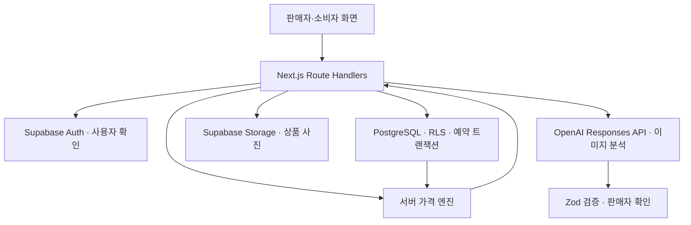

# 기술 설계와 작업 위치

[시작 안내](../README.md) · 근거: [기획 원문](../plan.md) §2, §5

## 확정 기술 스택

| 영역 | 기술 | 책임 |
| --- | --- | --- |
| 웹 | Next.js 16 App Router / TypeScript | 하나의 앱에서 판매자·소비자 화면 제공 |
| 스타일 | Tailwind CSS / shadcn/ui | 모바일 우선, 공통 컴포넌트 재사용 |
| 인증·데이터·파일 | Supabase Auth / PostgreSQL / Storage | 계정, RLS, 상품·재고·예약·판매, 사진 |
| 지도 | NAVER Maps Web Dynamic Map / Geocoding | 매장 지도 표시, 서버 경유 주소 검색 |
| 서버 | Next.js Route Handlers / Zod | API, 입력·AI 응답 검증 |
| AI | OpenAI Responses API | 이미지 분석과 구조화된 결과 제안 |
| 가격 | TypeScript 규칙 엔진 | 조회 시 계산, 예약 시 확정 |
| 리포트 | Recharts | 저장된 판매 데이터 시각화 |
| 배포·협업 | Vercel / GitHub / Codex / Claude Code | 배포, PR, AI 보조 개발 |

npm과 Supabase Auth SSR 방식을 유지합니다. Node.js 24.14.1·npm 11.11.0 기준으로 패키지와 설정을 준비했습니다. 설치 버전·명령은 [개발 환경](SETUP.md)을 확인합니다. package-lock.json 한 개로 의존성을 관리합니다.

## 데이터 흐름

AI 분석과 가격 계산은 별도 처리입니다. AI 호출 뒤 반드시 가격 계산을 수행하는 직렬 파이프라인이 아닙니다. 조회 시 가격을 계산하므로 주기적 가격 변경 스케줄러는 두지 않습니다.

## 디렉터리 지도

아래 경로는 `src/` 기준입니다(`supabase/`, `tests/` 제외). 일부는 아직 생성하지 않았습니다.

| 경로 제안 | 담당 | 내용 |
| --- | --- | --- |
| `app/(seller)/seller/` | A | 등록·상품 관리·예약 관리 화면. `layout.tsx`가 매장 등록 판매자만 허용 |
| `app/(seller)/seller/publish/` | 총괄 | 상품 게시 폼·내 상품 목록 |
| `app/(seller)/store/` | 총괄 | 매장 등록·수정 화면. 주소 입력은 `_components/address-field.tsx` |
| `app/(seller)/seller/report/` | C | A 경로 아래의 명시적 예외: 리포트 화면 |
| `app/(customer)/shop/`, `app/(customer)/shop/products/` | B | 지역 탐색·상품 상세 |
| `app/(customer)/shop/reservations/` | B | 내 예약 목록·상세·취소 UI |
| `app/(auth)/` | C | 로그인·회원가입 화면 |
| `app/(marketing)/` | C | 진입 안내 화면. 추가 기능은 범위 협의 |
| `app/layout.tsx`, `app/globals.css` | C, 총괄 협의 | 루트 레이아웃·전역 스타일 |
| `components/seller/` | A | 판매자 전용 컴포넌트 |
| `components/customer/` | B | 소비자 전용 컴포넌트 |
| `components/common/`, `components/report/` | C | 공통 UI·리포트 |
| `components/ui/` | C, 총괄 조율 | shadcn/ui 생성·수정 |
| `app/api/` | 총괄 | Route Handlers |
| `types/api.ts`, `lib/schemas/` | 총괄 | 공유 TypeScript 타입·Zod 스키마 |
| `lib/client/` | 총괄 | UI용 API 호출 모듈·인증 연결 |
| `lib/server/` | 총괄 | Supabase·AI·예약·리포트 로직 |
| `lib/pricing/` | 총괄 | 순수 가격 함수·중앙 설정 |
| `supabase/schema.sql` | 총괄 | 스키마·RLS·트랜잭션 함수 |
| `tests/` | 기능 담당, 총괄 통합 | 정책 테스트·API·통합 검증 |

아직 없는 경로는 협업 제안이며 해당 작업에서 생성합니다. 앱 루트 페이지, 공통 설정, 의존성·잠금 파일 변경도 총괄이 통합합니다. 아직 없는 파일을 읽거나 실행했다고 보고하지 않습니다.

## 개발 환경 인수인계 항목

L02 완료 시 총괄이 이 문서에 런타임·패키지 버전, 설치·실행·검증 명령, 개발 환경 접속 방법을 추가합니다. 환경 변수는 이름·용도·공개 가능 여부만 문서화하고 실제 값은 각자의 로컬 또는 배포 환경에서 관리합니다.

공개 가능한 Supabase 연결 정보와 서버 전용 OpenAI·서비스 역할 키를 구분합니다. 개발용 Supabase와 운영 데이터를 분리하고 테스트 계정·이미지 접근 권한을 준비합니다. 서비스 역할 키를 사용하는 서버 경로도 소유권 검증을 생략하면 안 됩니다.
